# Vorschaubilder Auftrag 6

**Simulator-Bilder, keine iPhone-Aufnahmen.** Erzeugt in der CI (GitHub Actions, iOS-Simulator) aus den
Snapshot-Tests `Packages/PaceKit/Tests/PaceSnapshotTests/Auftrag6SnapshotTests.swift` mit Beispieldaten und
gezeichneten Beispielbildern (Farbverlauf mit Symbol) statt echter Fotos. Fensterbilder (Home, Profil bearbeiten, Pace-Bot-Bildschirm)
mit Statusleiste in 393 × 852 pt; Seitenbilder ohne Statusleiste. Verkleinert auf 600 px Breite.

Bild 3: Echte Berührungen lassen sich im Simulator-Test nicht erzeugen. Der seitliche Versatz wird deshalb direkt
an der Scrollansicht der Seite gesetzt – mit Sperre setzt Pace ihn sofort zurück (Seite bleibt stehen), im
Vergleichsbild ohne Sperre bleibt er stehen. Das zeigt die Wirkung der Sperre, ist aber keine Aufnahme des
ursprünglichen Fehlers vom iPhone. Im Bild mit Sperre fehlt unten ein Teil der Seite: ein Darstellungsfehler der
Nachstellung im Snapshot-Renderer (die Seite steht an derselben Stelle wie in Bild 2), kein Fehler der App.

Erzeugt aus dem CI-Lauf zu Commit `bd0ae18` (iOS-Simulator, GitHub Actions).

| Nr. | Ansicht | Bilder | Vorschau |
|---|---|---|---|
| 1 | Home im normalen Zustand | [Hell](01-home-light.png) · [Dunkel](01-home-dark.png) | 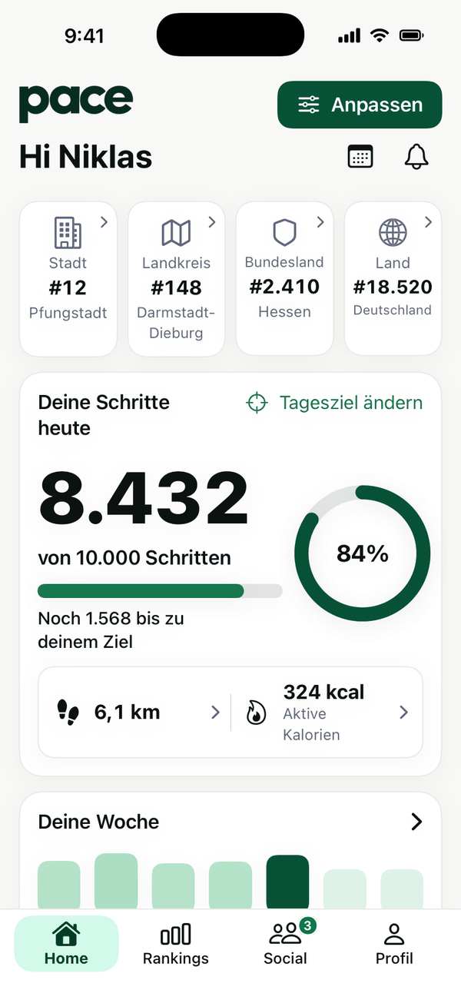 |
| 2 | Home im Anpassen-Modus | [Hell](02-home-anpassen-light.png) · [Dunkel](02-home-anpassen-dark.png) | 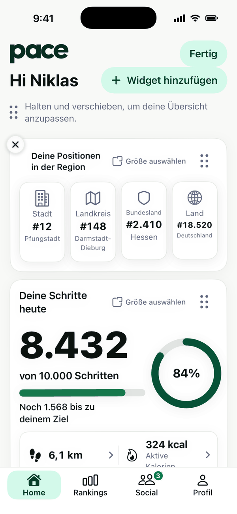 |
| 3 | Anpassen-Modus nach seitlichem Verschieben um 64 pt (mit Sperre: Seite bleibt stehen) | [Hell](03-home-anpassen-nach-wischen-light.png) · [Dunkel](03-home-anpassen-nach-wischen-dark.png) | 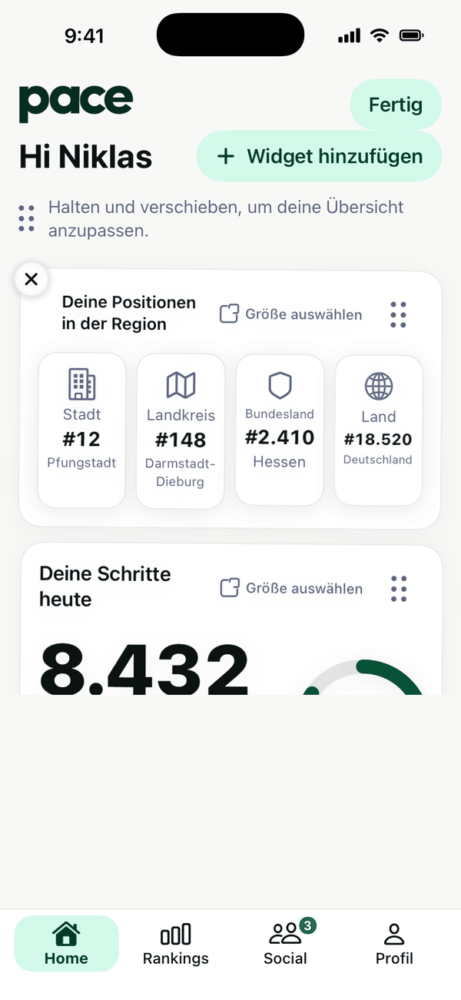 |
| 3 | Vergleich: derselbe Versatz ohne Sperre (früherer Zustand, nachgestellt) | [Hell](03-vergleich-ohne-sperre-light.png) · [Dunkel](03-vergleich-ohne-sperre-dark.png) | 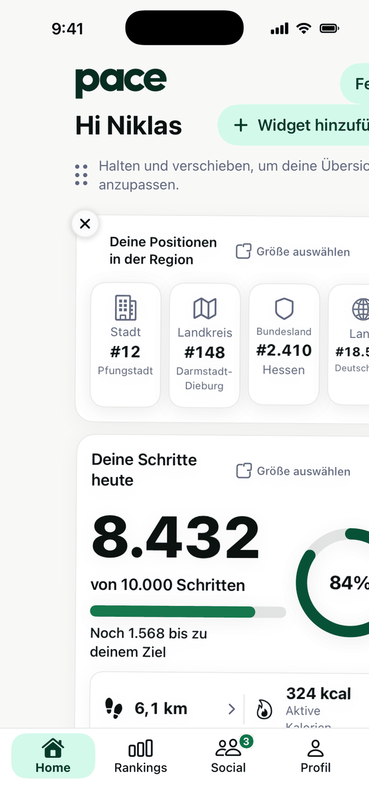 |
| 4 | Widget am Griff verschieben (angehoben) | [Hell](04-widget-verschieben-light.png) · [Dunkel](04-widget-verschieben-dark.png) | 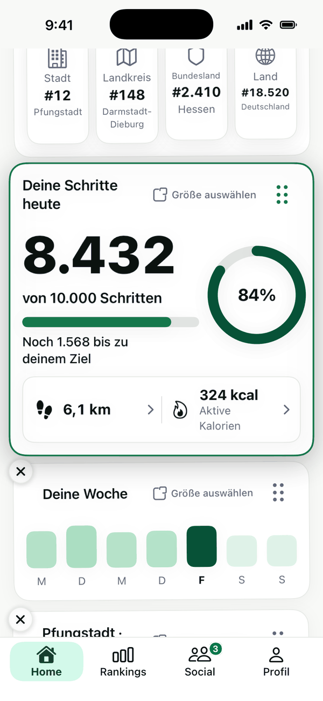 |
| 5 | Profilbilder im Home-Widget „Freunde“ | [Hell](05-profilbild-home-light.png) · [Dunkel](05-profilbild-home-dark.png) | 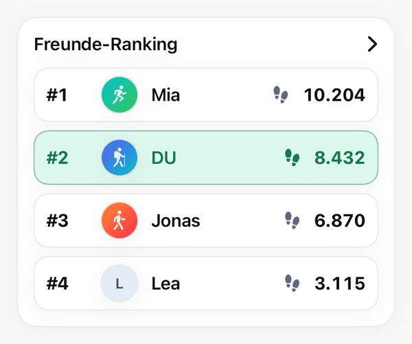 |
| 6 | Profilbilder im Freunde-Ranking | [Hell](06-profilbild-freunde-ranking-light.png) · [Dunkel](06-profilbild-freunde-ranking-dark.png) | 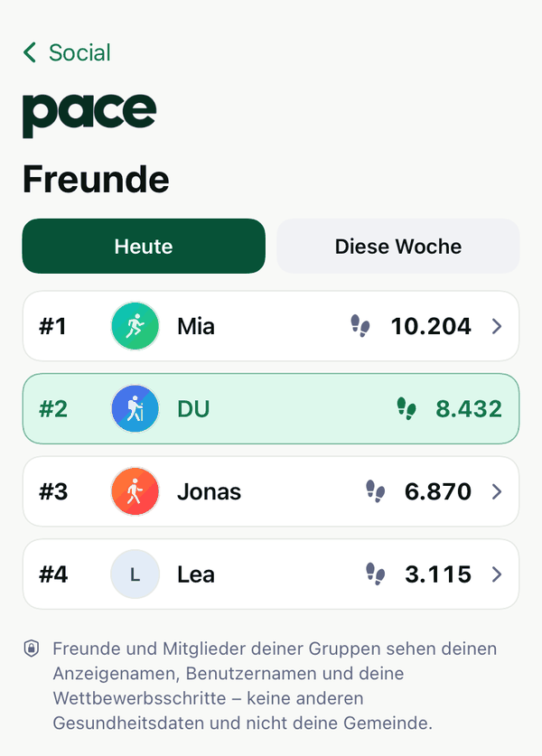 |
| 7 | Gruppenbild im Gruppen-Widget | [Hell](07-gruppenbild-widget-light.png) · [Dunkel](07-gruppenbild-widget-dark.png) | 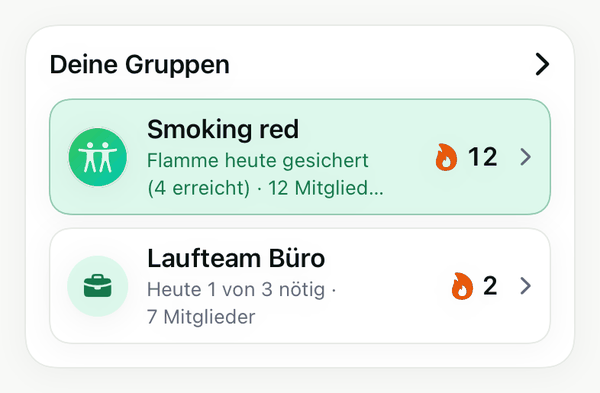 |
| 8 | Gruppenbild in der Gruppeninfo | [Hell](08-gruppenbild-gruppeninfo-light.png) · [Dunkel](08-gruppenbild-gruppeninfo-dark.png) | 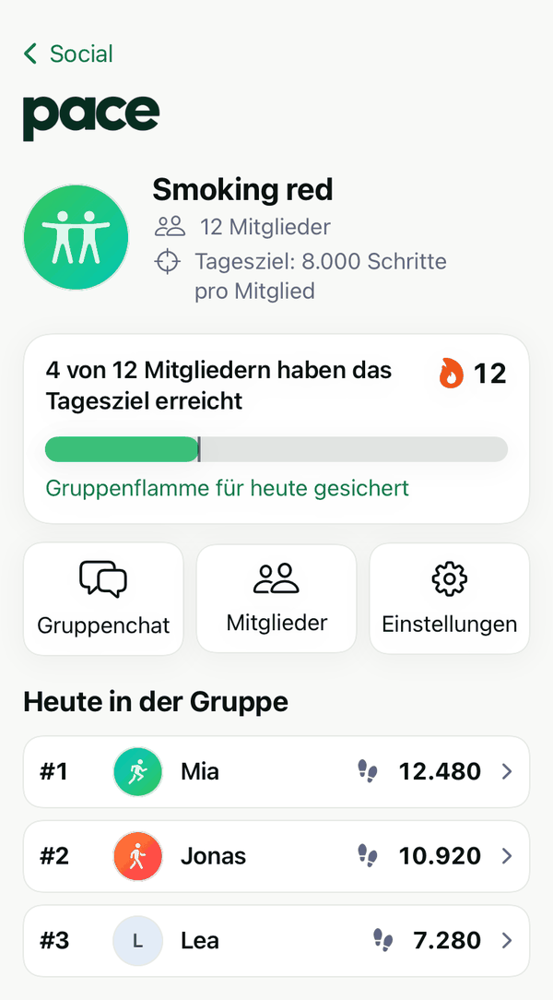 |
| 9 | Eigenes Profil mit Banner, Bio, Interessen, Auszeichnungen | [Hell](09-eigenes-profil-mit-banner-light.png) · [Dunkel](09-eigenes-profil-mit-banner-dark.png) · [EN](09-eigenes-profil-mit-banner-en-light.png) · [RU](09-eigenes-profil-mit-banner-ru-light.png) | 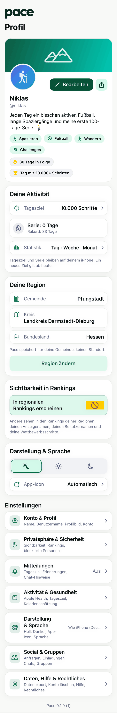 |
| 10 | Eigenes Profil ohne Banner und ohne neue Angaben | [Hell](10-eigenes-profil-ohne-banner-light.png) · [Dunkel](10-eigenes-profil-ohne-banner-dark.png) | 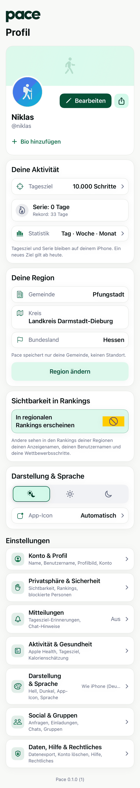 |
| 11 | Profil bearbeiten (Banner) | [Hell](11-profil-bearbeiten-light.png) · [Dunkel](11-profil-bearbeiten-dark.png) | 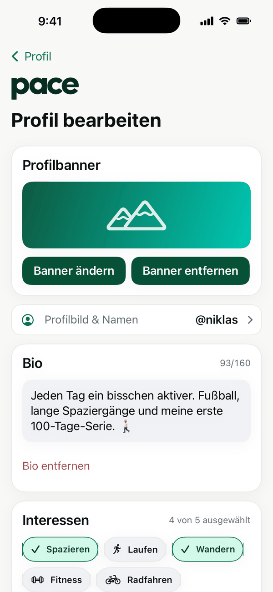 |
| 12 | Bio mit Zähler | [Hell](12-bio-bearbeiten-light.png) · [Dunkel](12-bio-bearbeiten-dark.png) | 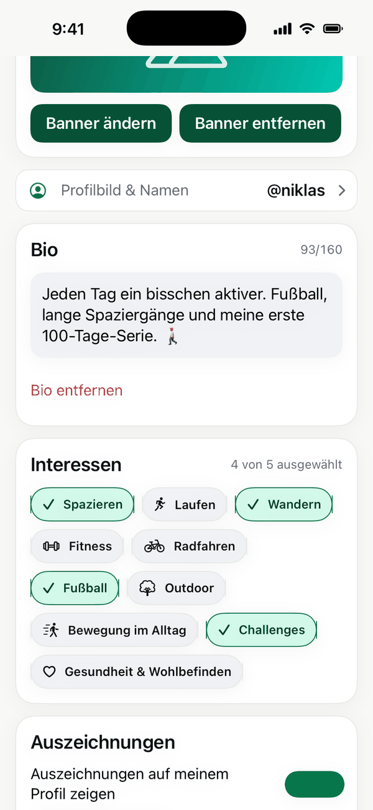 |
| 13 | Interessenauswahl (höchstens 5) und Auszeichnungen | [Hell](13-interessen-light.png) · [Dunkel](13-interessen-dark.png) | 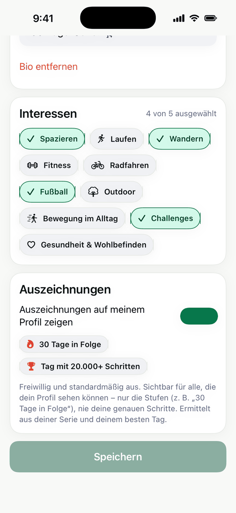 |
| 14 | Fremdes Profil (Auszeichnungen nicht freigegeben) | [Hell](14-fremdes-profil-light.png) · [Dunkel](14-fremdes-profil-dark.png) · [EN](14-fremdes-profil-en-light.png) · [RU](14-fremdes-profil-ru-light.png) | 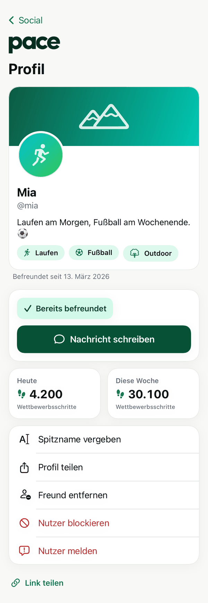 |
| 15 | Fremdes Profil mit freigegebenen Auszeichnungen | [Hell](15-profil-mit-auszeichnungen-light.png) · [Dunkel](15-profil-mit-auszeichnungen-dark.png) | 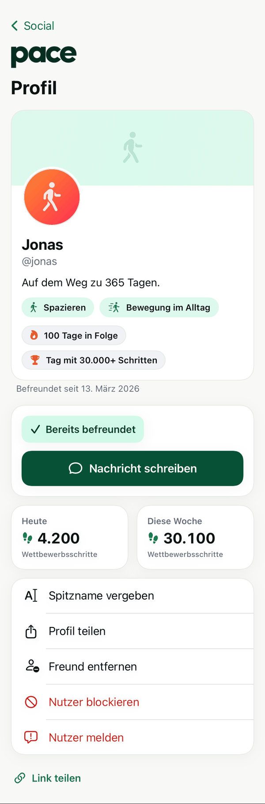 |
| 16 | Darstellungsauswahl mit Symbolen | [Hell](16-darstellung-light.png) · [Dunkel](16-darstellung-dark.png) · [EN](16-darstellung-en-light.png) · [RU](16-darstellung-ru-light.png) | 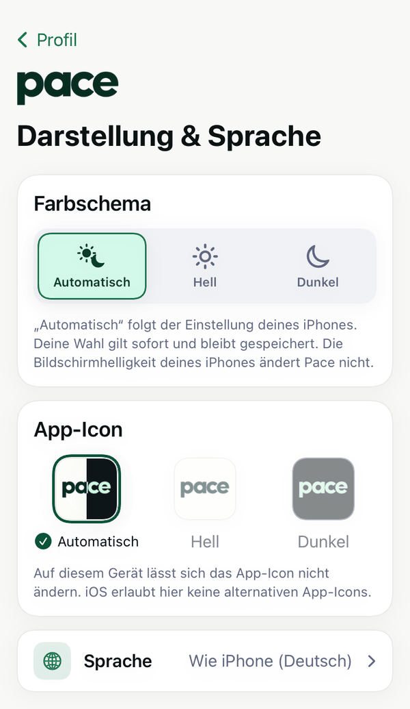 |
| 17 | Mitteilungscenter mit Willkommensmitteilung | [Hell](17-mitteilungen-willkommen-light.png) · [Dunkel](17-mitteilungen-willkommen-dark.png) · [EN](17-mitteilungen-willkommen-en-light.png) · [RU](17-mitteilungen-willkommen-ru-light.png) | 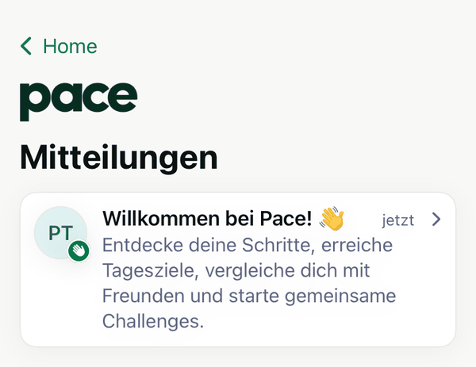 |
| 18 | Geöffnete Willkommensmitteilung | [Hell](18-willkommen-geoeffnet-light.png) · [Dunkel](18-willkommen-geoeffnet-dark.png) · [EN](18-willkommen-geoeffnet-en-light.png) · [RU](18-willkommen-geoeffnet-ru-light.png) | 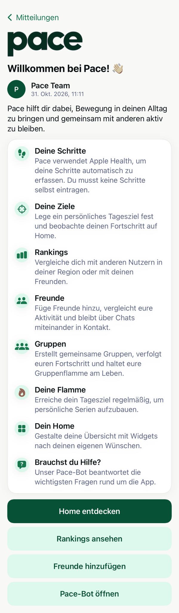 |
| 19 | Chatliste mit Pace-Bot | [Hell](19-chatliste-pace-bot-light.png) · [Dunkel](19-chatliste-pace-bot-dark.png) · [EN](19-chatliste-pace-bot-en-light.png) · [RU](19-chatliste-pace-bot-ru-light.png) | 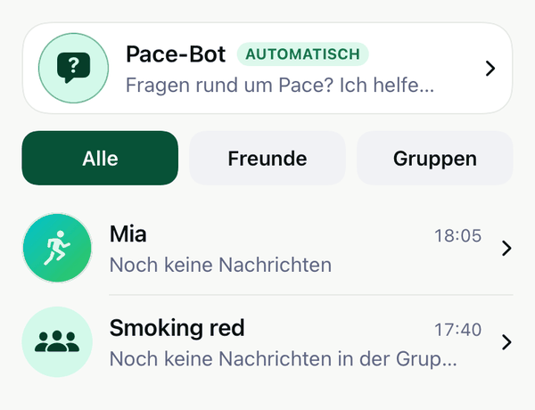 |
| 20 | Pace-Bot: Begrüßung und Fragen | [Hell](20-bot-begruessung-light.png) · [Dunkel](20-bot-begruessung-dark.png) · [EN](20-bot-begruessung-en-light.png) · [RU](20-bot-begruessung-ru-light.png) | 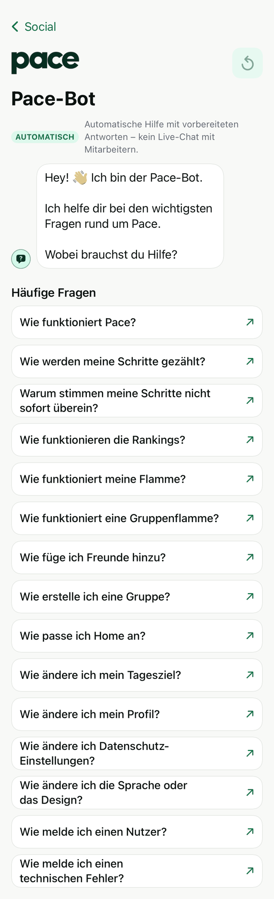 |
| 21 | Pace-Bot mit ausgewählter Frage | [Hell](21-bot-frage-light.png) · [Dunkel](21-bot-frage-dark.png) | 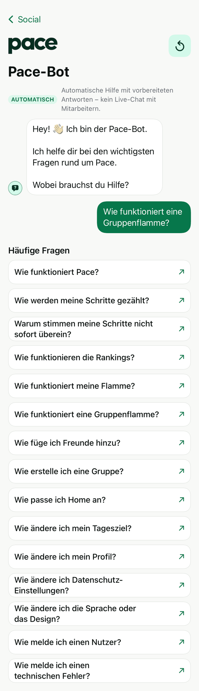 |
| 22 | Pace-Bot mit Antwort (Gruppenflamme), ganze Seite | [Hell](22-bot-antwort-light.png) · [Dunkel](22-bot-antwort-dark.png) · [EN](22-bot-antwort-en-light.png) · [RU](22-bot-antwort-ru-light.png) | 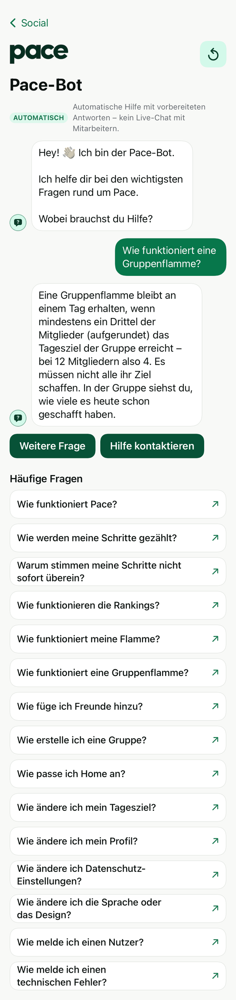 |
| 22 | Pace-Bot mit Antwort, so wie auf dem Bildschirm (Frage und Antwort oben) | [Hell](22-bot-antwort-bildschirm-light.png) · [Dunkel](22-bot-antwort-bildschirm-dark.png) | 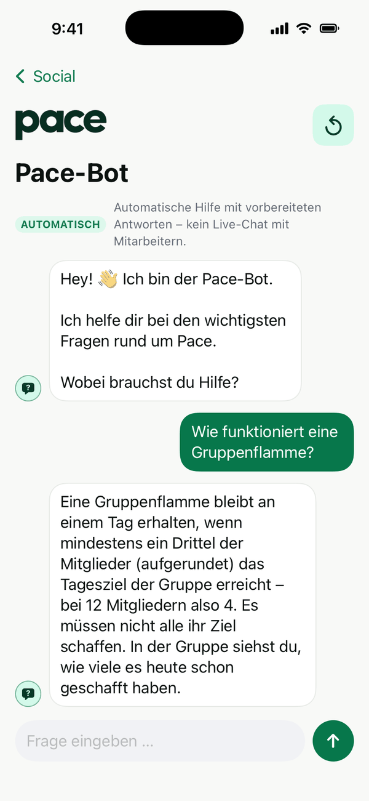 |
| 23 | Pace-Bot bei unbekannter Frage | [Hell](23-bot-unbekannt-light.png) · [Dunkel](23-bot-unbekannt-dark.png) | 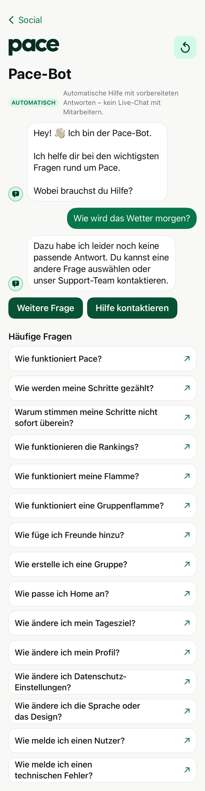 |
| 24 | Support-Verweis („Problem melden“, keine erfundene E-Mail) | [Hell](24-bot-support-light.png) · [Dunkel](24-bot-support-dark.png) · [EN](24-bot-support-en-light.png) · [RU](24-bot-support-ru-light.png) | 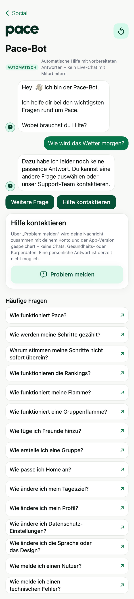 |

Erstellt mit `previews6.py` aus dem Artefakt `snapshots` des CI-Laufs (siehe STATUS_AUFTRAG6.md, Punkt 27).
