# Vorschaubilder Auftrag 7

**Simulator-Bilder, keine iPhone-Aufnahmen.** Erzeugt in der CI (GitHub Actions, iOS-Simulator) aus den
Snapshot-Tests `Packages/PaceKit/Tests/PaceSnapshotTests/Auftrag7SnapshotTests.swift` mit Beispieldaten und
gezeichneten Beispielbildern (Farbverlauf mit Symbol) statt echter Fotos. Fensterbilder (Home, Profil bearbeiten,
Editoren, Auswahllisten, Interessen, Profil nach der Rückkehr) mit nachgezeichneter Statusleiste in 393 × 852 pt;
Seiten- und Kopfbilder ohne Statusleiste. Verkleinert auf 600 px Breite. Längere Texte: Englisch und Russisch.

Bild 1 (vorher) stammt aus `docs/previews/auftrag6` (gleiche Beispieldaten). Die Kopfbilder 2 zeigen nur den Kopf
in vier Breiten und mit großer Schrift; dieselben Fälle prüft `HomeEditHeaderLayoutTests` bei jedem CI-Lauf
automatisch (Abstand der beiden Pillen ≥ 4 pt, rechtsbündig, nichts über den Rand).

Bild 6: Eine echte Wischgeste lässt sich im Snapshot nicht festhalten. Der Versatz wird deshalb über
`pacePeriodSwipePreviewOffset` gesetzt – genau der Wert, den die Geste während des Ziehens auf den Container
anwendet. So ist zu sehen, dass Karte und Diagramm als Ganzes verschoben werden.

Bekanntes Darstellungsartefakt: In den **hellen** Fensterbildern der Sheets (Bilder 9, 10, 14, 15) erscheint der
Titel der System-Navigationsleiste weiß und damit unsichtbar; in den dunklen Bildern ist er richtig. Die App setzt
keine eigene Titelfarbe (Systemstandard, Farbschema über `preferredColorScheme` in `RootView`); der Test-Renderer
übernimmt das helle Schema für diesen UIKit-Teil nicht. Auf dem iPhone bitte mitprüfen (IPHONE_TEST 5 D, 5 E).

Erzeugt aus dem CI-Lauf zu Commit `6931c1c` (iOS-Simulator, GitHub Actions).

| Nr. | Ansicht | Bilder | Vorschau |
|---|---|---|---|
| 1 | Home-Anpassen vorher (Stand Auftrag 6, Commit bd0ae18) | [Hell](01-home-anpassen-vorher-light.png) · [Dunkel](01-home-anpassen-vorher-dark.png) | 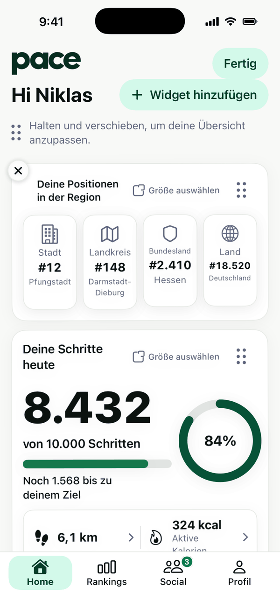 |
| 2 | Home-Anpassen nachher (iPhone 16, 393 pt) | [Hell](02-home-anpassen-nachher-light.png) · [Dunkel](02-home-anpassen-nachher-dark.png) | 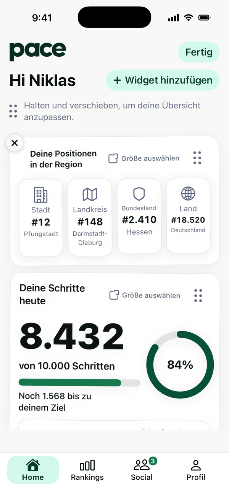 |
| 2 | Kopf nachher: iPhone SE mit Display-Zoom (320 pt) | [Hell](02-kopf-se-zoom-320-light.png) · [Dunkel](02-kopf-se-zoom-320-dark.png) · [EN](02-kopf-se-zoom-320-en-light.png) · [RU](02-kopf-se-zoom-320-ru-light.png) | 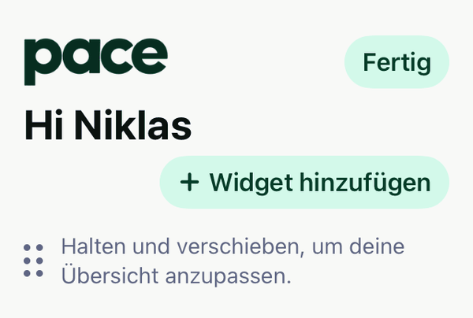 |
| 2 | Kopf nachher: iPhone SE (375 pt) | [Hell](02-kopf-se-375-light.png) · [Dunkel](02-kopf-se-375-dark.png) · [EN](02-kopf-se-375-en-light.png) · [RU](02-kopf-se-375-ru-light.png) | 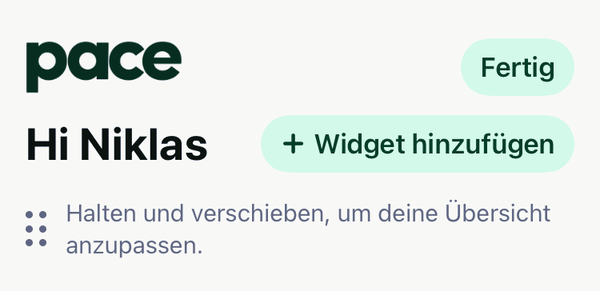 |
| 2 | Kopf nachher: iPhone 16 (393 pt) | [Hell](02-kopf-iphone16-393-light.png) · [Dunkel](02-kopf-iphone16-393-dark.png) · [EN](02-kopf-iphone16-393-en-light.png) · [RU](02-kopf-iphone16-393-ru-light.png) | 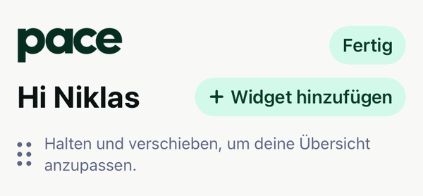 |
| 2 | Kopf nachher: Pro Max (430 pt) | [Hell](02-kopf-pro-max-430-light.png) · [Dunkel](02-kopf-pro-max-430-dark.png) · [EN](02-kopf-pro-max-430-en-light.png) · [RU](02-kopf-pro-max-430-ru-light.png) | 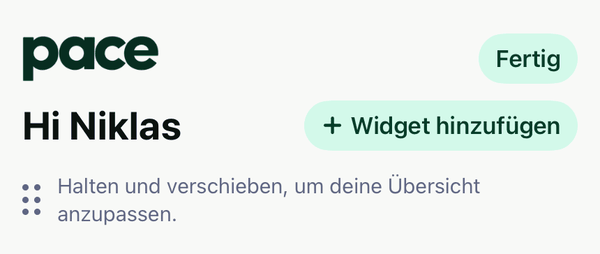 |
| 2 | Kopf nachher: iPhone SE mit großer Schrift (xxxLarge) | [Hell](02-kopf-se-grosse-schrift-light.png) · [Dunkel](02-kopf-se-grosse-schrift-dark.png) · [EN](02-kopf-se-grosse-schrift-en-light.png) · [RU](02-kopf-se-grosse-schrift-ru-light.png) | 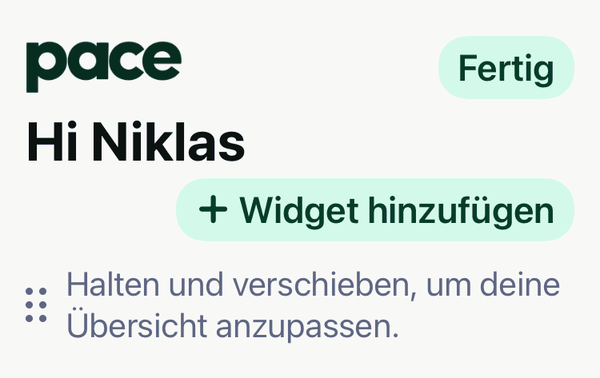 |
| 3 | Chatliste: Pace-Bot nie benutzt → ganz unten | [Hell](03-chatliste-bot-unbenutzt-light.png) · [Dunkel](03-chatliste-bot-unbenutzt-dark.png) · [EN](03-chatliste-bot-unbenutzt-en-light.png) · [RU](03-chatliste-bot-unbenutzt-ru-light.png) | 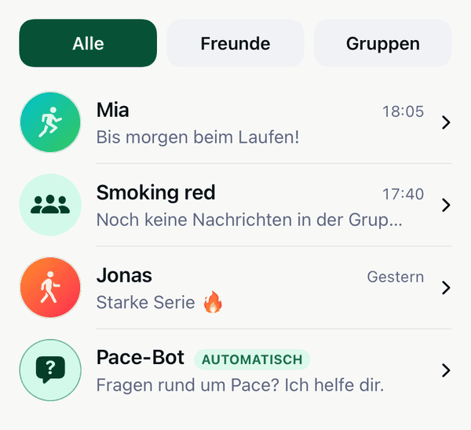 |
| 4 | Chatliste: nach neuer Gruppennachricht steht die Gruppe über dem Bot | [Hell](04-chatliste-nach-gruppennachricht-light.png) · [Dunkel](04-chatliste-nach-gruppennachricht-dark.png) · [EN](04-chatliste-nach-gruppennachricht-en-light.png) · [RU](04-chatliste-nach-gruppennachricht-ru-light.png) | 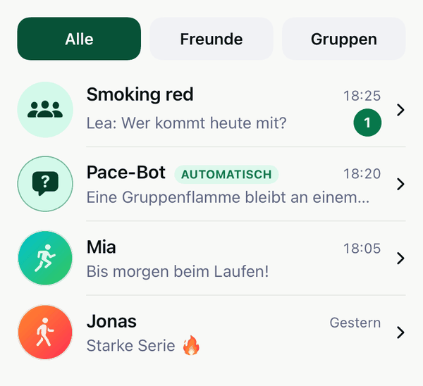 |
| 5 | Chatliste: nach eigener Bot-Frage steht der Bot oben | [Hell](05-chatliste-nach-bot-frage-light.png) · [Dunkel](05-chatliste-nach-bot-frage-dark.png) · [EN](05-chatliste-nach-bot-frage-en-light.png) · [RU](05-chatliste-nach-bot-frage-ru-light.png) | 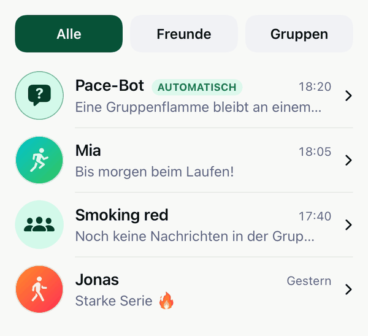 |
| 6 | Tagesstatistik während der Geste (Finger 110 pt nach rechts, nachgestellt) | [Hell](06-statistik-tag-waehrend-wischen-light.png) · [Dunkel](06-statistik-tag-waehrend-wischen-dark.png) | 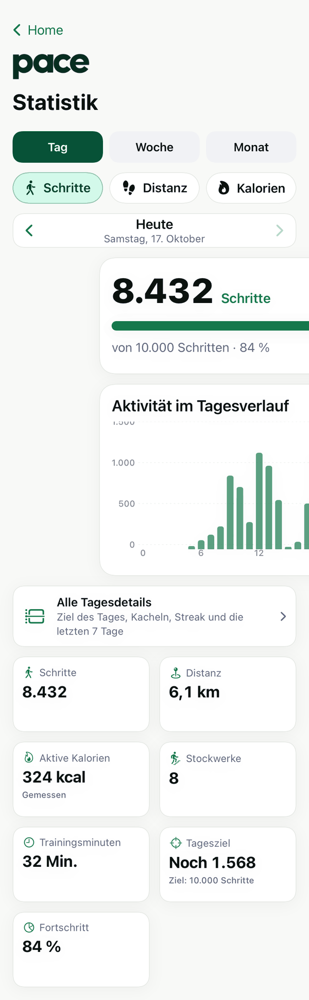 |
| 6 | Wochenstatistik (Distanz) während der Geste | [Hell](06-statistik-woche-waehrend-wischen-light.png) · [Dunkel](06-statistik-woche-waehrend-wischen-dark.png) | 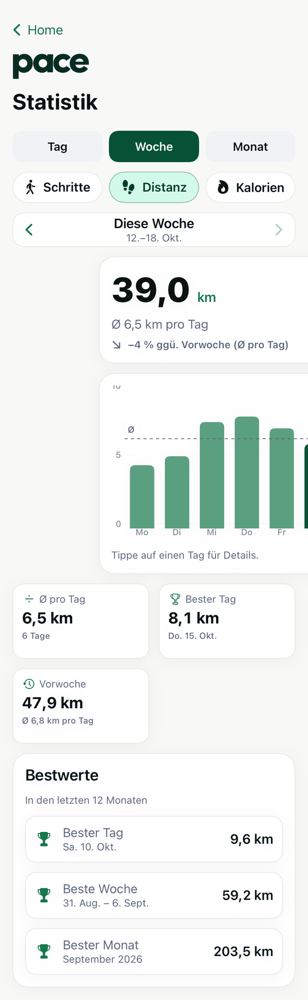 |
| 6 | Monatsstatistik (Kalorien) während der Geste | [Hell](06-statistik-monat-waehrend-wischen-light.png) · [Dunkel](06-statistik-monat-waehrend-wischen-dark.png) | 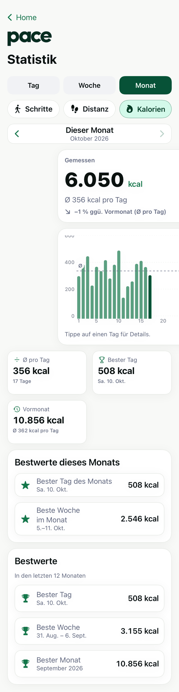 |
| 7 | Tagesstatistik nach dem Einrasten (vier Tage zurück, 13. Oktober) | [Hell](07-statistik-tag-eingerastet-light.png) · [Dunkel](07-statistik-tag-eingerastet-dark.png) · [EN](07-statistik-tag-eingerastet-en-light.png) · [RU](07-statistik-tag-eingerastet-ru-light.png) | 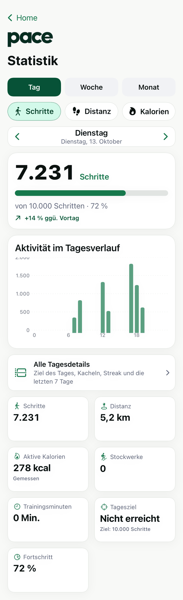 |
| 7 | Wochenstatistik (Distanz) nach dem Einrasten (Vorwoche) | [Hell](07-statistik-woche-eingerastet-light.png) · [Dunkel](07-statistik-woche-eingerastet-dark.png) | 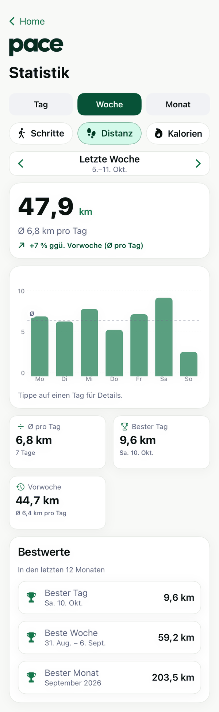 |
| 7 | Monatsstatistik (Kalorien) nach dem Einrasten (zurück und wieder vor) | [Hell](07-statistik-monat-eingerastet-light.png) · [Dunkel](07-statistik-monat-eingerastet-dark.png) | 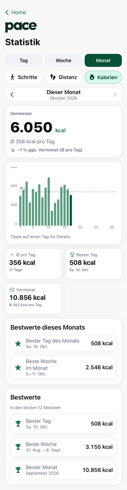 |
| 8 | Profil bearbeiten mit Banner und Profilbild (antippen zum Ändern) | [Hell](08-profil-bearbeiten-bilder-light.png) · [Dunkel](08-profil-bearbeiten-bilder-dark.png) | 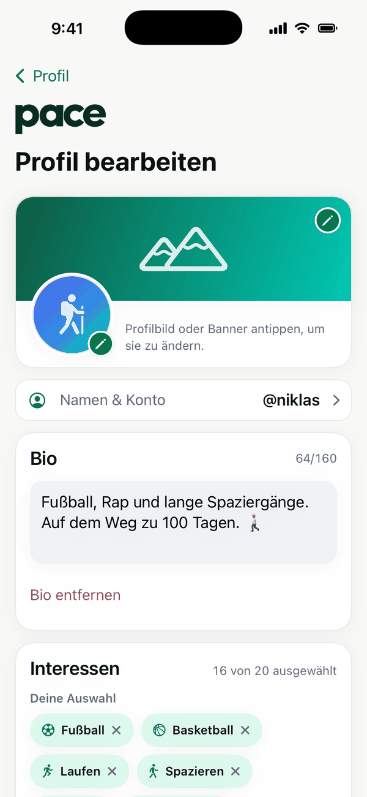 |
| 9 | Profilbild-Editor (quadratischer Ausschnitt, runde Vorschau) | [Hell](09-profilbild-editor-light.png) · [Dunkel](09-profilbild-editor-dark.png) | 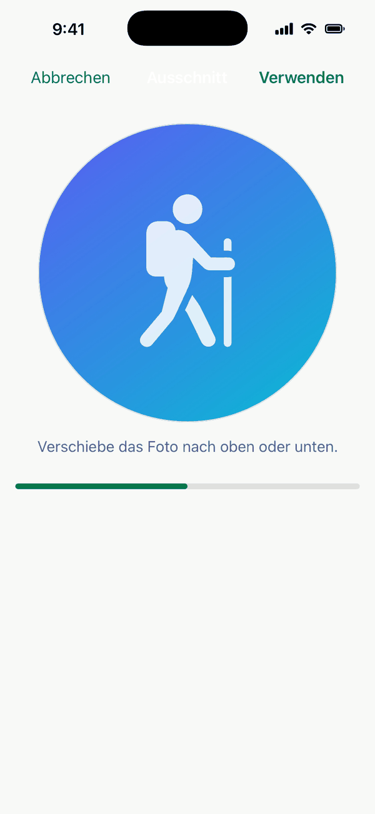 |
| 10 | Banner-Editor (Ausschnitt 3:1) | [Hell](10-banner-editor-light.png) · [Dunkel](10-banner-editor-dark.png) | 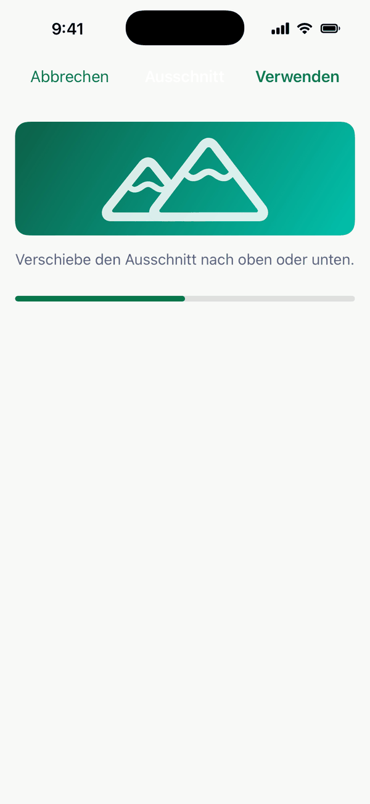 |
| 11 | Erweiterter Interessenkatalog in Kategorien | [Hell](11-interessen-katalog-light.png) · [Dunkel](11-interessen-katalog-dark.png) | 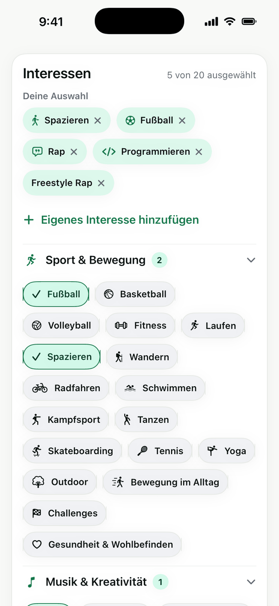 |
| 11 | Interessenkatalog weiter unten (Technik & Gaming, Alltag, Sprachen & Kultur) | [Hell](11-interessen-katalog-weiter-light.png) · [Dunkel](11-interessen-katalog-weiter-dark.png) | 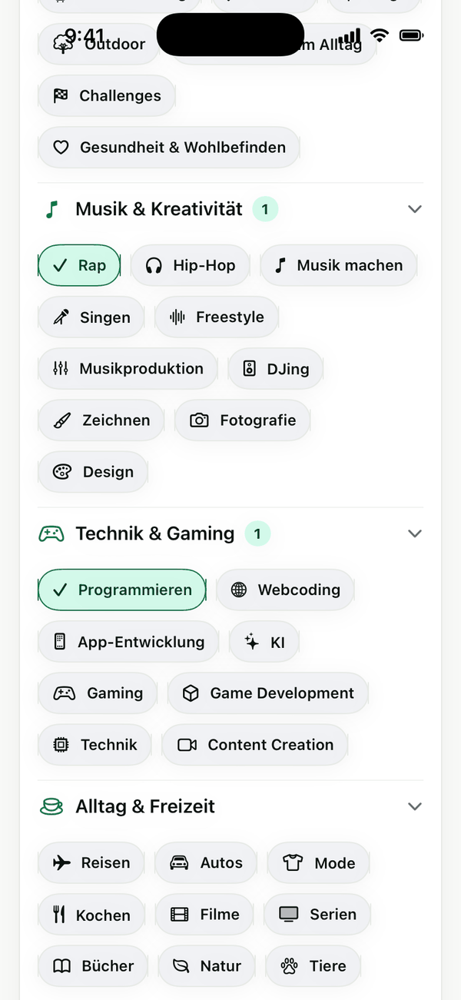 |
| 11 | Ohne neue Migration: ursprünglicher Katalog, höchstens 5 | [Hell](11-interessen-alter-server-light.png) · [Dunkel](11-interessen-alter-server-dark.png) | 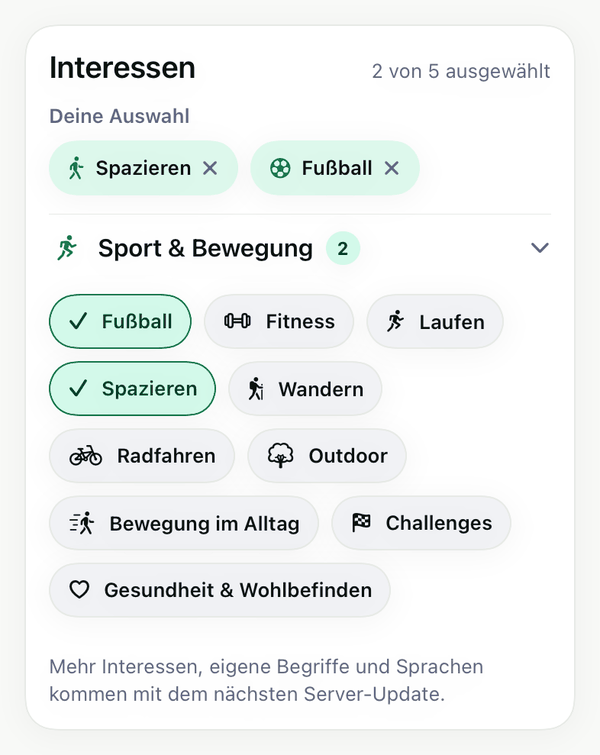 |
| 12 | Eigenes Interesse hinzufügen | [Hell](12-eigenes-interesse-light.png) · [Dunkel](12-eigenes-interesse-dark.png) | 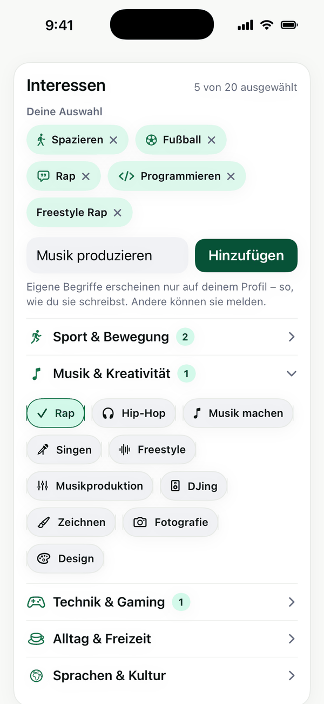 |
| 12 | Eingabe „basketball“: Pace schlägt den Katalogeintrag vor | [Hell](12-katalog-vorschlag-light.png) · [Dunkel](12-katalog-vorschlag-dark.png) | 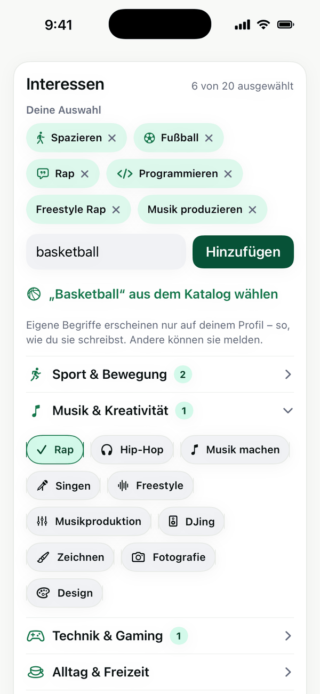 |
| 12 | Doppelter Begriff in anderer Schreibweise: „Schon ausgewählt.“ | [Hell](12-doppelt-light.png) · [Dunkel](12-doppelt-dark.png) | 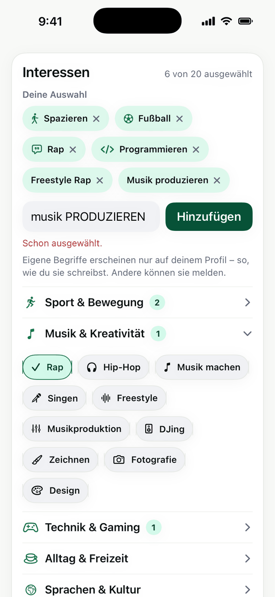 |
| 13 | Eigenes Profil mit 16 Interessen, Sprachen und Land | [Hell](13-profil-viele-interessen-light.png) · [Dunkel](13-profil-viele-interessen-dark.png) · [EN](13-profil-viele-interessen-en-light.png) · [RU](13-profil-viele-interessen-ru-light.png) | 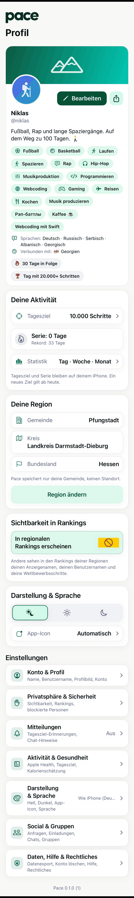 |
| 13 | Fremdes Profil: sechs Interessen und „Alle Interessen ansehen“ | [Hell](13-fremdes-profil-kompakt-light.png) · [Dunkel](13-fremdes-profil-kompakt-dark.png) · [EN](13-fremdes-profil-kompakt-en-light.png) · [RU](13-fremdes-profil-kompakt-ru-light.png) | 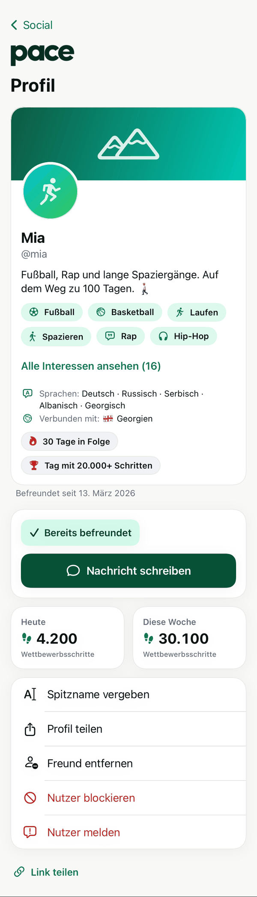 |
| 14 | Bereiche „Gesprochene Sprachen“ und „Land & Kultur“ | [Hell](14-sprachen-und-land-light.png) · [Dunkel](14-sprachen-und-land-dark.png) · [EN](14-sprachen-und-land-en-light.png) · [RU](14-sprachen-und-land-ru-light.png) | 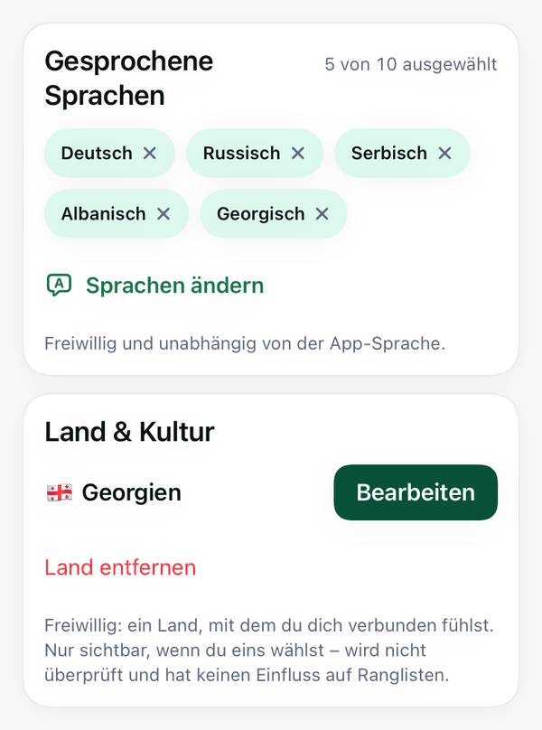 |
| 14 | Sprachauswahl (Liste) | [Hell](14-sprachauswahl-light.png) · [Dunkel](14-sprachauswahl-dark.png) | 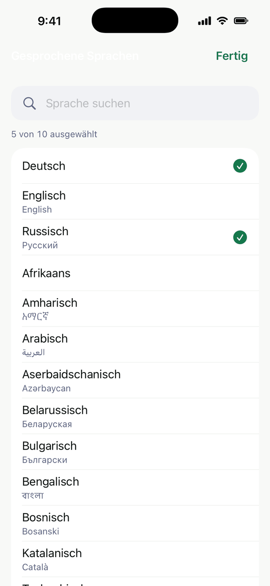 |
| 14 | Sprachauswahl mit Suche „Serb“ | [Hell](14-sprachsuche-light.png) · [Dunkel](14-sprachsuche-dark.png) | 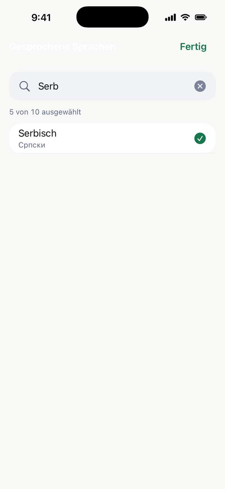 |
| 15 | Land & Kultur: Auswahl mit Suche „Ge“ | [Hell](15-landauswahl-light.png) · [Dunkel](15-landauswahl-dark.png) | 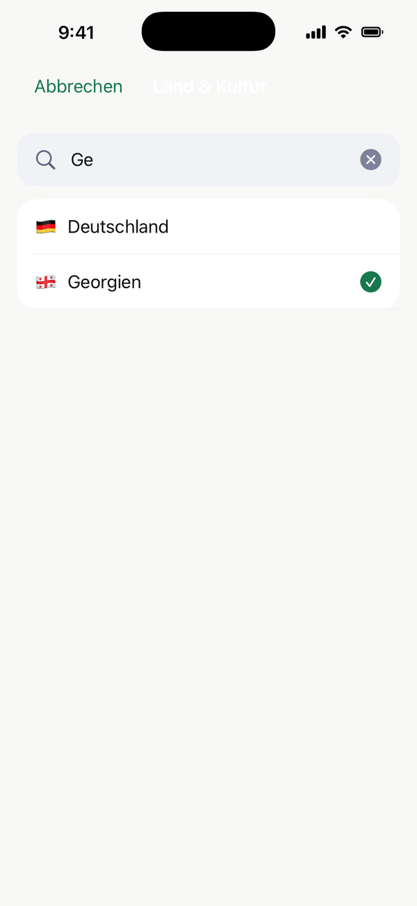 |
| 16 | Profil-Hauptseite nach Wechsel zu Social und zurück | [Hell](16-profil-nach-rueckkehr-light.png) · [Dunkel](16-profil-nach-rueckkehr-dark.png) | 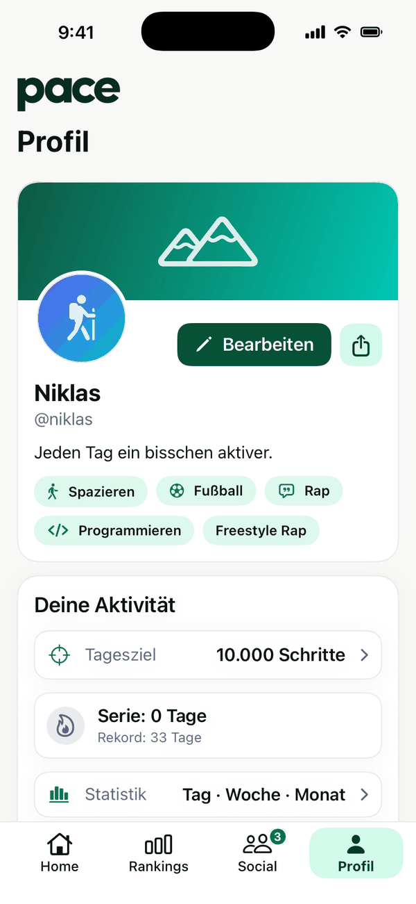 |

Erstellt mit `previews7.py` aus dem Artefakt `snapshots` des CI-Laufs (siehe STATUS_AUFTRAG7.md, Punkt 18).
